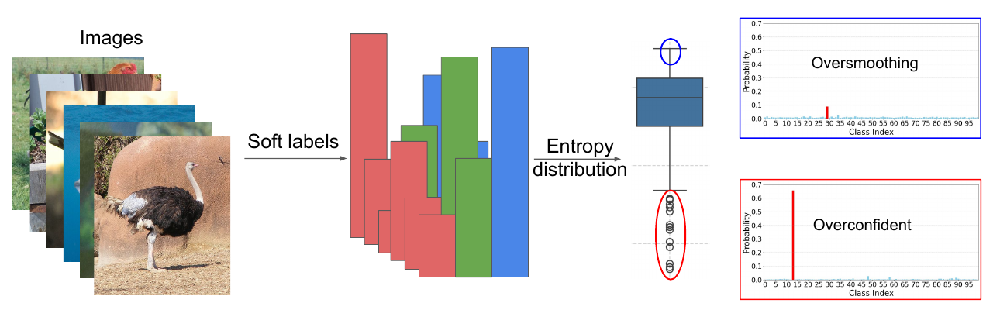
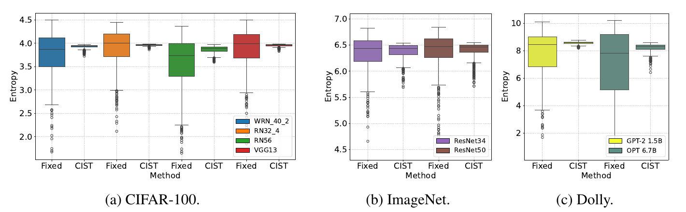

<div align="center">

# CIST: Consistently Informative Soft-Label Temperature for Knowledge Distillation

**Hoang-Chau Luong\*, Nghia Van Vo\*, Kaiqi Zhao, Lingwei Chen**
<br><sub>\* equal contribution</sub>

[](https://arxiv.org/abs/2605.20357)
[](#installation)
[](https://pytorch.org)



<i>With one fixed temperature, some teacher soft labels stay <b>overconfident</b> while others are <b>oversmoothed</b>.</i>

</div>

## The idea

Standard KD divides all logits by **one global temperature**, so the "dark knowledge" in teacher soft labels is
very uneven across samples. CIST fixes this with three small changes to the KD loss:

| | What CIST does | Why |
| :---: | --- | --- |
| 1 | **Sample-wise temperature** $\tau_i = \max(\max_c \hat v_{i,c} / \rho,\ 1)$ | keeps soft-label entropy consistent across samples |
| 2 | **Separate temperatures** for teacher and student | no rigid teacher–student logit-scale matching |
| 3 | **Rescale KL by** $\tau^t_i\,\tau^s_i$ | confidence-aware curriculum over samples |

<div align="center">

<br><i>Teacher soft-label entropy: fixed temperature (wide, many outliers) vs. CIST (consistent).</i>
</div>

<br>

It is a drop-in replacement for the KD loss, with a single knob $\rho$ (smaller $\rho$ = smoother targets):

```python
import torch.nn.functional as F

def cist_kl(student_logits, teacher_logits, rho=3.0):
    t = teacher_logits - teacher_logits.mean(-1, keepdim=True)            # mean-centered logits
    s = student_logits - student_logits.mean(-1, keepdim=True).detach()
    tau_t = (t.max(-1).values / rho).clamp(min=1)                         # sample-wise temperatures
    tau_s = (s.detach().max(-1).values / rho).clamp(min=1)
    kl = F.kl_div(F.log_softmax(s / tau_s[:, None], -1), F.softmax(t / tau_t[:, None], -1),
                  reduction="none").sum(-1)
    return (kl * tau_t * tau_s).mean()                                    # confidence-aware reweighting
```

## Results

| Task | Teacher → Student | Baseline | **CIST** |
| --- | --- | :---: | :---: |
| CIFAR-100 (top-1) | ResNet32x4 → ResNet8x4 | 73.33 (KD) | **76.96** |
| | WRN-40-2 → WRN-16-2 | 74.92 (KD) | **76.59** |
| | ResNet50 → MobileNetV2 | 67.35 (KD) | **69.87** |
| ImageNet (top-1) | ResNet34 → ResNet18 | 71.03 (KD) | **71.97** |
| | ResNet50 → MobileNetV1 | 70.50 (KD) | **72.75** |
| Dolly (avg. ROUGE-L) | GPT-2 1.5B → GPT-2 0.1B | 21.37 (RKL) | **22.32** |
| | OPT 6.7B → OPT 1.3B | 23.26 (RKL) | **24.76** |

Full tables and more baselines are in the [paper](https://arxiv.org/abs/2605.20357).

## Installation

```bash
git clone https://github.com/lhchau/cist-informative-temp-kd.git
cd cist-informative-temp-kd
pip install -r vision/requirements.txt   # image classification
pip install -r llm/requirements.txt      # language models (needs CUDA GPUs)
```

## Quick start

### Image classification

1. Download the standard CIFAR-100 teachers (`cifar_teachers.tar` from
   [mdistiller](https://github.com/megvii-research/mdistiller/releases/tag/checkpoints)) and extract them to
   `vision/checkpoints/`. ImageNet teachers use torchvision weights; put ImageNet in `vision/data/imagenet/{train,val}`.
2. Train a student:

```bash
cd vision
python train.py --config configs/cifar100/cist.yaml    # ResNet32x4 -> ResNet8x4, rho = 3
```

Any config entry can be overridden on the command line:

```bash
python train.py --config configs/cifar100/cist.yaml \
    model.teacher=wrn_40_2 model.arch=wrn_16_2 \
    model.teacher_ckpt=checkpoints/cifar_teachers/wrn_40_2_vanilla/ckpt_epoch_240.pth \
    loss.rho=4.0 seed=1
```

Checkpoints and a per-epoch `log.jsonl` are written to `outputs/<dataset>/<method>/<teacher>_<student>_seed<seed>/`.

### Language models

```bash
cd llm
bash scripts/download.sh                                        # Dolly + eval sets + GPT-2 XL teacher
bash scripts/distill.sh gpt2 cist --rho <rho>                   # GPT-2 XL -> GPT-2 Base, 4 GPUs
bash scripts/eval.sh gpt2 results/gpt2/cist/seed10/best_rougeL  # Dolly, Vicuna, Super-NI, UnNI x 5 seeds
python tools/collect_results.py results/gpt2/cist/seed10/best_rougeL
```

For OPT, use `opt` instead of `gpt2` and point `TEACHER=<path>` to an SFT OPT-6.7B checkpoint
(`bash scripts/sft.sh opt facebook/opt-6.7b` trains one).

## Reproducing the paper

Run these inside `vision/` or `llm/`:

| Paper | Folder | Command |
| --- | --- | --- |
| Table 2 — CIFAR-100 | `vision` | `bash scripts/cifar100.sh kd` / `cist` &nbsp;(`SEEDS="42 43 44"` for 3 runs) |
| Table 3 — ImageNet | `vision` | `bash scripts/imagenet.sh kd` / `cist` |
| Table 1 — entropy outliers | `vision` | `python train.py --config configs/cifar100/kd_entout_ce.yaml` (or `kd_entout_ht`) |
| Table 4 — Dolly | `llm` | `bash scripts/distill.sh <gpt2\|opt> <fkl\|rkl\|symkl\|jsd\|srkl\|akl\|ab\|cist>`, then `eval.sh` |
| Fig. 2, 3a — entropy | `vision` | `python analyze_entropy.py --teacher resnet32x4 --ckpt <path> --rhos 2 3 4 5 --plot entropy.png` |
| Fig. 3b — sensitivity | `vision` | `python train.py --config configs/cifar100/cist.yaml loss.rho=4.0 loss.kl_weight=6.0` |
| Fig. 4 — t-SNE | `vision` | `python tsne.py --arch resnet8x4 --ckpt <student best.pth>` |

<details>
<summary><b>Training recipes</b> (Appendix A)</summary>

<br>

| | CIFAR-100 | ImageNet | Dolly (LLM) |
| --- | --- | --- | --- |
| Optimizer | SGD, momentum 0.9 | SGD, momentum 0.9 | AdamW |
| Epochs / batch | 240 / 64 | 100 / 512 | 20 / 32 |
| Learning rate | 0.05 (0.01 for MobileNetV2 / ShuffleNetV2) | 0.2 | 5e-4 (GPT-2), 5e-5 (OPT), cosine |
| LR decay | ×0.1 at epochs 150, 180, 210 | ×0.1 at epochs 30, 60, 90 | cosine |
| Weight decay | 5e-4 | 1e-4 | 0.01 |
| CIST | ρ = 3, λ<sub>KL</sub> = 8 | ρ = 3, λ<sub>KL</sub> = 8 | applied to reverse KL |

Choosing ρ: `python analyze_entropy.py --num-samples 512 --rhos 2 2.5 3 3.5 4` (in `vision/`) prints the soft-label entropy
for each ρ; pick one in the middle of the range between the teacher's raw entropy and `log(#classes)`.

LLM baselines follow DistiLLM: Sym-KL = 0.5 FKL + 0.5 RKL, SRKL α = 0.1, AB (α, β) = (0.2, 0.7).

</details>

<details>
<summary><b>Repository structure</b></summary>

```
vision/                      CIFAR-100 & ImageNet
├── train.py                 teacher (CE) or student (KD / CIST / KD-EntOut) training
├── losses.py                KD, CIST, KD-EntOut
├── analyze_entropy.py       soft-label entropy: fixed T vs. CIST
├── tsne.py                  t-SNE of student features
├── configs/                 cifar100/*.yaml, imagenet/*.yaml
├── scripts/                 cifar100.sh, imagenet.sh
└── models/                  CIFAR and ImageNet architectures
llm/                         instruction-following distillation (Dolly)
├── finetune.py              distillation / teacher SFT (DeepSpeed)
├── evaluate.py              sampling + ROUGE-L
├── losses.py                FKL, RKL, Sym-KL, JS, SRKL, AKL, AB, CIST
├── scripts/                 download.sh, distill.sh, sft.sh, eval.sh
└── tools/                   process_data_dolly.py, collect_results.py
```

</details>

## Acknowledgements

Built on [CRD](https://github.com/HobbitLong/RepDistiller), [mdistiller](https://github.com/megvii-research/mdistiller),
[MiniLLM](https://github.com/microsoft/LMOps/tree/main/minillm) and [DistiLLM](https://github.com/jongwooko/distillm).

## Citation

```bibtex
@article{luong2026cist,
  title   = {Consistently Informative Soft-Label Temperature for Knowledge Distillation},
  author  = {Luong, Hoang-Chau and Vo, Nghia Van and Zhao, Kaiqi and Chen, Lingwei},
  journal = {arXiv preprint arXiv:2605.20357},
  year    = {2026}
}
```
